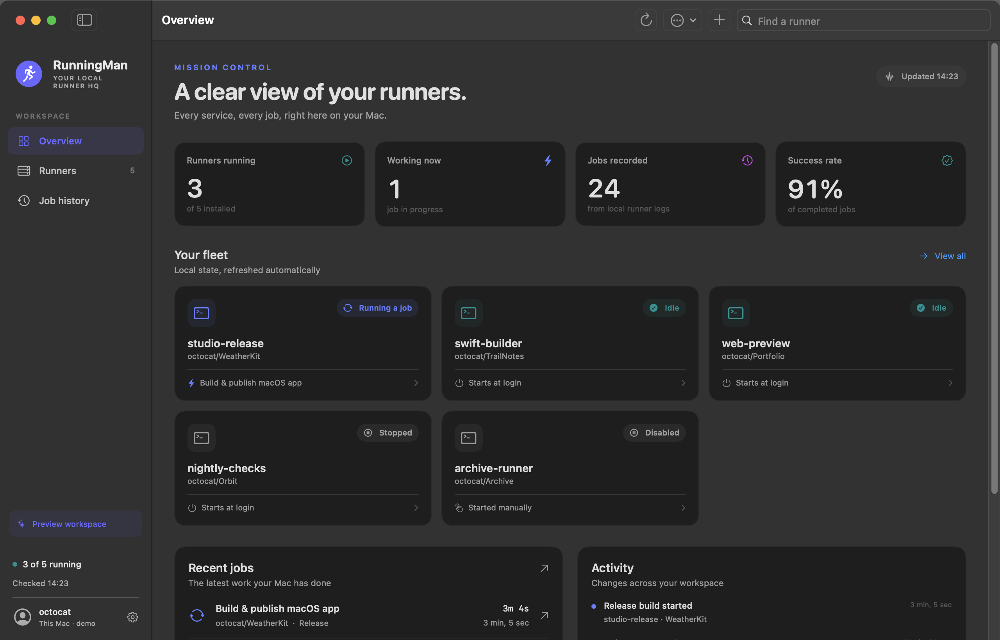
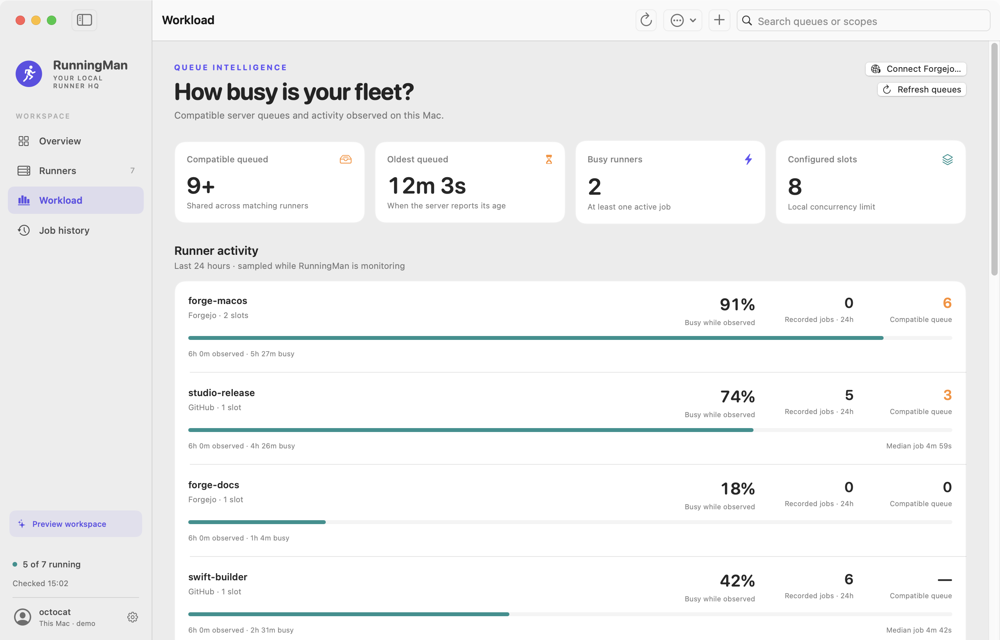

# RunningMan

A native macOS home for your self-hosted GitHub Actions and Forgejo runners.

> [!IMPORTANT]
> LLM disclosure: This codebase was written with substantial help from large language models: AI coding agents working from the [`AGENTS.md`](AGENTS.md) brief in this repo.

See what is installed, what is working, what ran, and what will start when you log in. RunningMan discovers existing installations in place and keeps their configuration and workspaces where they are.

The preview above uses fictional runners and jobs.

## A little mission control for your Mac

- **Live fleet overview.** Running, busy, stopped and disabled runners, with job counts, success rate and recent activity.
- **Queues and utilisation.** Compatible queued jobs, server-reported wait times, job slots and sampled busy rates, with explicit coverage and availability.
- **Release cleanup reports.** See when a release removed its temporary build workspace, estimated bytes and files removed, and any incomplete cleanup.
- **Independent controls.** Start and stop now, enable or disable a runner, and choose whether it starts at login.
- **Finish the job first.** Stop a busy runner after its current job finishes; cancel that request any time. RunningMan must remain open until it stops the runner.
- **Create and remove.** Register a repository or organization runner from its GitHub URL, download and verify the official runner, and install its user service. Unregister existing runners without deleting their workspaces.
- **Job history.** Search and filter locally recorded jobs, see outcomes and durations, and jump to their GitHub run when its URL is available.
- **Job log.** Follow a GitHub runner's current job step by step, like the log on GitHub, read from the runner's local files with secrets redacted.
- **Ghost lap.** Watch a GitHub runner's job race a ghost of its usual run: whether it is ahead or behind, which step is slow, and when it should be done.
- **Live diagnostics.** Search and follow redacted logs, reveal installations in Finder, and export a diagnostic report.
- **Menu-bar access.** Check the fleet and manage runners even after closing the main window.
- **Background mode.** Open RunningMan at login in the menu bar, without its window or Dock icon. With automatic refresh on, the menu bar and widgets stay current.
- **Desktop widgets.** See runner availability and recorded job results in small or medium widgets.
- **Notifications.** Opt in to a notification when a job fails or succeeds, or when a runner stops without you stopping it. Click one to open that runner.
- **Keep builds awake.** Optionally prevent idle sleep while a job is running. Closing the lid can still put a laptop to sleep.

RunningMan is an independent personal project. It uses SwiftUI and AppKit, with no third-party dependencies.

## Download

Requires macOS 14 or later.

<!-- latest-release -->[RunningMan-v1.5.1-macos-universal.zip](https://github.com/L-K-M/RunningMan/releases/download/v1.5.1/RunningMan-v1.5.1-macos-universal.zip)<!-- /latest-release --> (or an older one from the [releases](https://github.com/L-K-M/RunningMan/releases) list), unzip, and copy **RunningMan.app** to Applications. The build is ad-hoc signed, not notarized: open it once, click Done, then System Settings → Privacy & Security → Open Anyway (Control-click → Open on macOS 14).

Once installed, RunningMan checks a small public manifest file once a day and shows a banner when a newer release exists. Turn it off in Settings → Updates.

## Build and open

Requires macOS 14 or later and Xcode 16 or later with its command-line tools selected.

~~~sh
swift test
scripts/build-app.sh --universal --zip
open dist/RunningMan.app
~~~

The build creates an ad-hoc signed app, a ZIP and its SHA-256 checksum in **dist/**. Copy **RunningMan.app** to Applications if you want to keep it there. This is a development build; Developer ID signing and notarization are not configured.

The app icon is generated from [Resources/AppIcon.png](Resources/AppIcon.png) at all ten standard macOS sizes on each build. Its [artwork prompt](Resources/AppIcon.prompt.txt) records how the retro action-poster illustration was created. To refresh the tracked ICNS after changing the PNG, run `swift scripts/make-icon.swift Resources`.

For a faster native development build:

~~~sh
scripts/build-app.sh --debug
open dist/RunningMan.app
~~~

## Existing runners

Open RunningMan. It checks runner installation folders immediately below your home directory, `~/actions-runners` and `~/GitHubRunners`, its own managed runner directory, folders referenced by your user LaunchAgents, Forgejo system LaunchDaemons that run as your account, and folders you imported. Entries in `~/actions-runners`, `~/GitHubRunners` and the managed runner directory can be symbolic links to another volume. Use **Import existing runner…** for installations elsewhere.

RunningMan does not look inside the standard folders in your home directory (Applications, Desktop, Documents, Downloads, Library, Movies, Music, Pictures and Public), so macOS does not ask you for access to them. Import a runner stored in Documents, Desktop or Downloads with **Import existing runner…**, unless a user LaunchAgent already refers to it. Each folder listing is limited to 512 entries; RunningMan warns you when a folder has more.

Discovery reads non-secret runner metadata and local diagnostics. It never executes a discovered runner or reads its credential files. Opening the app does not start, stop or reconfigure runners.

The three controls mean different things:

| Control | Effect |
| --- | --- |
| Start / Stop | Changes whether the runner is running now. Stopping preserves the next-login setting. |
| Enabled / Disabled | Determines whether the runner can be started. Disabling also stops it; enabling does not start it. |
| Start at login | Sets the user service's next-login policy. Changing it does not restart a live runner. |

These are macOS user LaunchAgents: automatic startup happens **after you sign into that Mac account**, rather than before login. See [GitHub's macOS service instructions](https://docs.github.com/en/actions/how-tos/manage-runners/self-hosted-runners/configure-the-application?platform=mac).

Local process state is shown as **running**, not as a claim that GitHub can currently reach the runner. Stop, disable and removal refuse uncertain or busy process state unless you explicitly confirm an interruption.

## Create a runner

Install and sign into the GitHub CLI once:

~~~sh
brew install gh
gh auth login
~~~

Choose **New Runner**, enter a GitHub.com repository or organization URL, a runner name and any custom labels, then create it. Repository registration requires repository administration access; organization registration requires organization ownership. Both private and public GitHub.com repositories are supported, subject to their organization policies. GitHub Enterprise Server registration is not yet supported.

RunningMan uses the existing GitHub CLI session, downloads the matching official macOS runner, verifies its published SHA-256 and archive paths, and requests a short-lived registration token. The token is passed through the runner's secret input environment and is never saved by RunningMan or placed in command arguments.

Managed installations live in **~/Library/Application Support/RunningMan/Runners/**. Creation starts the runner immediately; the checkbox separately controls startup at future logins. Setup errors preserve the installation and report its path. If registration completed, import that folder to inspect it; if it did not, move the incomplete folder to Trash before retrying.

Registering a runner does not rewrite repository workflows. Use the runner's labels in the relevant job's runner selection, for example:

~~~yaml
runs-on: [self-hosted, macOS]
~~~

## Forgejo runners

Choose **New Runner → Forgejo**, enter your HTTPS server URL, and connect with a Forgejo access token. RunningMan checks the token with your server first and saves it in your login Keychain only if the server accepts it. Repository, organization, personal-account and instance registration scopes are supported; the token needs runner-management permission for the selected scope. Forgejo 15 or later and Forgejo Runner 13.2 or later are required for this setup flow.

RunningMan installs the checksummed Homebrew core `forgejo-runner` package when needed and copies its native binary into the new runner directory. It uses its own user LaunchAgent rather than starting a global Homebrew service. Install Homebrew first. JavaScript workflow actions also need a compatible Node.js installation on the Mac; the runner package does not bundle it.

Native Mac labels use the `:host` suffix, such as `macos-arm64:host`; use `macos-arm64` in the workflow's `runs-on`. Capacity is the maximum number of concurrent jobs. Start with one for Xcode builds unless the Mac has enough resources for more.

Discovery reads RunningMan's public descriptor and user LaunchAgent metadata. It never opens Forgejo's credential-bearing `.runner` or YAML configuration files. Existing installations referenced by an owned user login service can be discovered and controlled in place; importing an arbitrary folder alone cannot safely recover private registration metadata. Removing a runner from Forgejo requires its numeric registration ID, scope and API access.

A Forgejo daemon installed as a system LaunchDaemon in **/Library/LaunchDaemons** with your account as its `UserName` appears for monitoring only: process, live log and job history. RunningMan never starts, stops, disables, unregisters or edits system services; manage those with an administrator account. Without a RunningMan descriptor, its activity shows **Unknown** and its labels and server are not shown. Jobs the server cancels or fails are recorded from the daemon log; other outcomes are not logged at the default level and remain **Unknown**.

For Homebrew services, the login checkbox also handles simple KeepAlive policies. RunningMan preserves the original policy in a private backup and restores it only if the service has not otherwise changed. Complex startup conditions are reported for manual configuration.

## Queues and usage

Open **Workload** and enable server monitoring. It is off by default. GitHub uses the existing GitHub CLI sign-in; **Connect Forgejo** saves an origin-specific API token in Keychain. Reads happen about once a minute, with request limits, timeouts and rate-limit backoff. Local process monitoring continues separately.

Queue counts include jobs whose labels match known local runners. A job belongs to a compatible pool, so several machines may be able to claim it. Counts are deduplicated when the same job is visible through several scopes; they are not added once per compatible runner. The busiest visible queues appear first.

Repository and organization scans are bounded and disclose partial access or inspection limits. Organization scans cover up to eight of the most recently active repositories, fewer on GitHub when the per-refresh request budget cannot cover eight. Reading GitHub runner labels needs repository administration, or for organizations the `admin:org` scope (`gh auth refresh -h github.com -s admin:org`); without it, RunningMan infers labels from your runner's settings and lists matching jobs without a count. Forgejo account and instance scopes use its active-runner queue API; that API omits jobs blocked on dependencies or approvals. Unknown or unsupported data shows **Unavailable** or **—**, rather than an empty queue. Some Forgejo versions omit per-job runner assignment and timestamps: exact occupied slots and queue age cannot be reconstructed from those responses. GitHub queue age is shown only when the job itself reports a creation timestamp.

**Busy while observed** is an estimate from consecutive known idle/busy samples while RunningMan is monitoring. It shows the covered time explicitly; app downtime, uncertain activity and gaps over 15 seconds are excluded. It measures whether at least one job was active, not CPU load or the percentage of occupied slots on a multi-job runner. Up to 48 hours of bounded observations are stored privately; the view covers the last 24 hours. Recorded-job counts and median durations come separately from available local job history, which can be incomplete for Forgejo.

## Desktop widgets

After copying RunningMan to Applications, open it once. Control-click the desktop,
choose **Edit Widgets**, then search for **RunningMan**. Both widgets support small
and medium sizes:

- **Runner Fleet:** online, busy and attention counts; the medium size also shows
  stopped and disabled runners. Unverified activity stays labelled separately.
- **Job Results:** success rate and locally recorded jobs; the medium size adds
  succeeded, failed, cancelled and unknown outcomes. Success rate uses confirmed
  success, failure and cancellation outcomes, matching the dashboard.

Click a widget to open Overview or Job history. Keep RunningMan open for new
snapshots: turn on **Open at login in the menu bar** in Settings to keep it
running in the background. macOS schedules widget updates, so they can lag
behind the app. After 15 minutes without a fresh snapshot, the widget labels its
counts as cached and asks you to open the app. Missing or unreadable data shows
**Stats unavailable**.

The widget reads only aggregate counts from
**~/Library/Application Support/RunningMan/Widgets/stats.json**. It never reads
runner files, credentials, names or logs. Preview mode does not update this file.

## History and privacy

The **Cleanup** section reads reports written by participating release workflows. Each release builds in its own temporary source copy and removes that copy after upload attempts, including ordinary build or upload failures. The runner's configuration, diagnostic logs, development checkouts and shared tool caches remain outside that scope. Cleanup failure is reported separately from release upload success.

The reports live in the runner work directory's **.runningman-cleanup/** folder. RunningMan reads bounded, validated reports and never deletes files through this view. A pending report is not proof of a running job or successful removal: power loss or a force-killed runner can prevent the final step. Old releases without reports show no cleanup evidence. Sizes represent logical file contents removed, rather than measured free space on APFS. See [the workflow integration guide](docs/release-cleanup.md) to add this to another repository.

History is recovered from available local Runner and Worker diagnostics, then saved in **~/Library/Application Support/RunningMan/**. It is not a complete GitHub audit log. Rotated or deleted diagnostics cannot recover jobs that RunningMan has never seen. The step times of finished jobs are kept there too, at most 20 runs per job, so the next run can race them.

Unfinished jobs without evidence of a current worker show **Unknown**, with no invented completion time. Records with confirmed outcomes keep them when older logs are scanned again. Up to 2,000 jobs and 500 activity events are retained, with bounded log tails and incremental background reads.

The **Job log** tab shows the steps and output of a GitHub runner's most recent job while RunningMan is open. The runner uploads and deletes its output files during the job, so output from before RunningMan started, or from a gap between reads, is not shown; open the run on GitHub for the complete log. Output is kept in memory only, until the runner's next job. Forgejo runners send step output straight to the server, so the tab is not available for them.

Registration credentials are never read. Common credential formats and explicit operation tokens are redacted from displayed or exported logs. Diagnostic exports include runner names, repository names and local paths.

## Development

~~~sh
scripts/build.sh            # swift test + release app build
scripts/build.sh --debug    # or a debug build
scripts/smoke-test.sh
~~~

`scripts/build.sh` also accepts `--universal`, `--zip`, `--run`, `--install` (replaces `/Applications/RunningMan.app`) and `--clean`. To cut a release, run `scripts/release.sh 1.2.0` on a clean, pushed `main` (`--dry-run` checks first): it updates the marked download link above, commits, tags `v1.2.0` and pushes both, after which the release workflow builds and publishes the zip and announces it to installed apps.

The smoke test opens a clearly labelled synthetic preview workspace and saves ten screenshots under **.local/screenshots/**, including light/dark workload, cleanup and widget views, and fails if a section comes out blank. It captures only RunningMan's own windows, so it needs macOS 14.4 or later but no Screen Recording permission. It never controls installed runners or changes your saved window layout. You can explore that preview manually:

~~~sh
open -na dist/RunningMan.app --args --demo
~~~

The [architecture notes](docs/architecture.md) describe discovery, service semantics, history and testing. Pull requests run the test suite, build the universal app, check its signature and render the preview UI on a GitHub-hosted Mac. The workflow can also be started manually.

## License

[The Unlicense](LICENSE).
